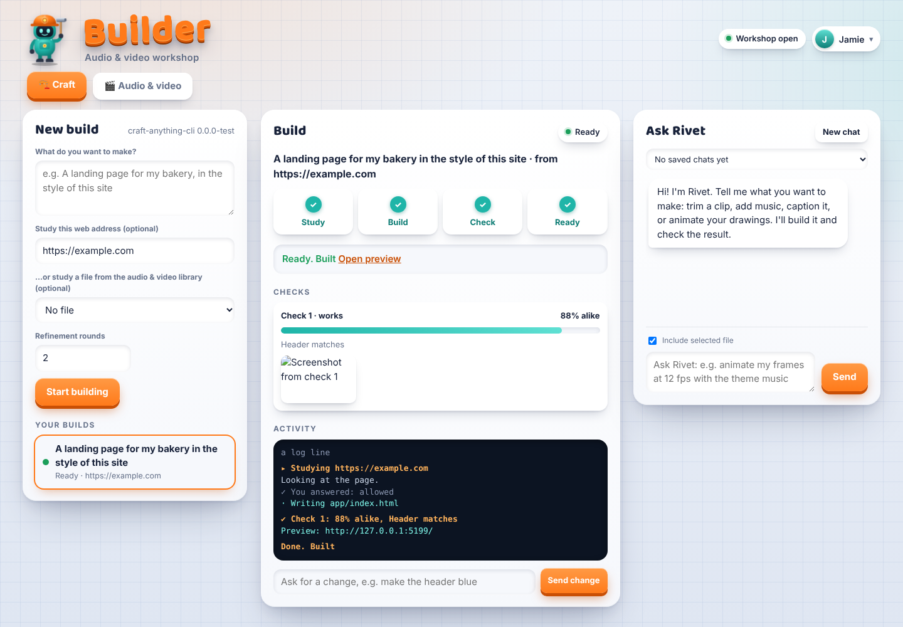
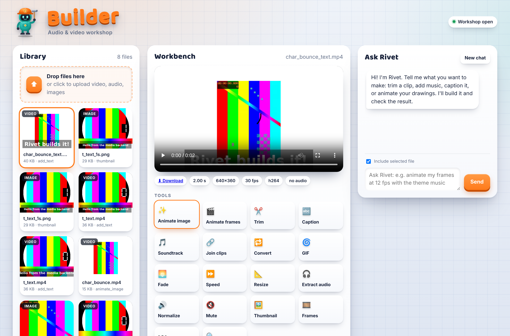

# Builder



**Builder runs on the [Craft Anything](https://github.com/storytold/craft-anything) engine, with its
own front end and its own audio/video workshop on top.**

- **Craft builds (the foundation):** point Builder at a website, app or game (or start from
  nothing) and say what you want. The engine studies the original, a coding agent builds your own
  version in a project folder, and the result is checked against the original (how alike, in
  percent) and refined. You see each step live and approve anything that runs outside the project.
  The engine is a copy of Craft Anything in [`engine/`](engine/BUILDER.md) that you can extend.
- **The audio & video workshop (yours):** 18 local ffmpeg tools (trim, captions, soundtracks,
  joining clips, GIFs, frame-by-frame and still-image animation). It is also plugged into the
  engine, so Craft's builder can use these tools while it builds.
- **Rivet, accounts and Claude Code:** one assistant, one sign-in, and one connector for both parts.

## Use Builder from anywhere

Builder runs in one place, and everything else just connects to it. Nothing else needs to install
or set it up.

**1. Run it (once, on the computer or server that hosts it)**

```bash
pip install -e .              # from this repository
builder setup                 # builds the Craft engine into ~/.builder/bin and checks ffmpeg
export ANTHROPIC_API_KEY=...  # for Rivet and Craft builds
builder serve                 # http://127.0.0.1:8000/  (add --host 0.0.0.0 to let other devices in)
```

Everything lives in `~/.builder`: accounts, files, Craft projects and the engine. The web app, other
apps and Claude Code all share it. `builder doctor` shows what's ready.

**2. Use it in the browser:** open the address above, make your account, and use the **Craft** and
**Audio & video** tabs.

**3. Use it from other apps:** every feature is an HTTP API (docs at `/docs`). Authenticate with a
personal token: *your name → Connect Claude Code* in the web app, or `builder token --user NAME`.

```bash
curl -H "Authorization: Bearer mbp_..." http://127.0.0.1:8000/craft/projects
```

```python
from media_backend.client import Builder        # one stdlib-only file; copy it anywhere
b = Builder("http://127.0.0.1:8000", token="mbp_...")
run = b.build("A landing page for my bakery", target="https://example.com")
for event in b.follow(run["id"]):
    print(event)
```

A web app on another site calling Builder from the browser needs its address in
`MEDIA_BACKEND_CORS_ORIGINS` (comma-separated). It uses a token; sign-in cookies are never shared.

**4. Use it from another Claude Code chat:** connect the chat to the running Builder. In the web
app, *Connect Claude Code* gives you this command, ready to paste. `-s user` makes it available in
every project:

```bash
claude mcp add --transport http builder -s user http://127.0.0.1:8000/mcp/ --header "Authorization: Bearer mbp_..."
```

That chat then has all of Builder's tools (`craft_build_start`, `craft_build_status`, `trim`,
`animate_image`, `ask_assistant`, …). Its builds and Rivet chats are yours, in your account.

- On the same computer you can instead let Claude Code start Builder itself, with no server and no
  token: `claude mcp add builder -s user -e BUILDER_USER=<your username> -- builder mcp`.
- A Claude Code chat in the cloud (claude.ai/code) can only reach a Builder that's on the internet:
  run `builder serve` on a server behind HTTPS and use that address in the command above. A Builder
  on your own computer is reachable only from that computer and your local network.


1. Build the engine once (see [`engine/BUILDER.md`](engine/BUILDER.md)):
   `cd engine && cargo build --release -p craft-anything-cli`
2. Set `ANTHROPIC_API_KEY` for the server. Builder gives it to the engine as its builder AI the
   first time a build starts (in Builder's own engine settings, `MEDIA_BACKEND_DATA/engine-config`).
   Without a key, the engine uses a coding-agent app it finds on the computer, such as Claude Code.
3. Open the **Craft** tab, say what to make, optionally give a web address or a file from the
   library, and press **Start building**.

Each person's builds and projects are private to them (`MEDIA_BACKEND_DATA/projects/<username>/`).
Approvals ("Run `npm install`?") are always the person's: Rivet and Claude Code can start and
follow builds and answer the builder's questions, but can't approve actions.

| Method & path | Purpose |
|---|---|
| `GET /craft/status` | Is the engine built, and which version |
| `POST /craft/runs` `{request, target?, file_id?, rounds?}` | Start a build |
| `GET /craft/runs`, `GET /craft/runs/{id}?after=N&wait=S` | Your builds; a build's events (long-poll) |
| `POST /craft/runs/{id}/answer` `{choice?, text?, allow?, always?}` | Answer a question or approval |
| `POST /craft/runs/{id}/stop`, `POST /craft/runs/{id}/followup` `{request}` | Stop; ask for a change |
| `GET /craft/projects`, `GET /craft/projects/file?path=` | Your projects; a project's file (e.g. a check screenshot) |

Rivet's and the connector's Craft tools: `craft_build_start`, `craft_build_status`,
`craft_build_answer`, `craft_build_followup`, `craft_build_stop`, `craft_projects_list`,
`craft_engine_tools_search` and `craft_engine_tool` (the engine's ~330 analysis tools; ones that
run foreign code are refused).

# The audio & video workshop



An audio/video processing backend you can reuse from any project. It has three parts:

1. **Media API** (HTTP, FastAPI + ffmpeg): upload files, run operations, download the results.
2. **Built-in assistant** (Claude): describe what you want in plain words and it plans and runs the
   operations, then looks at its own results before reporting back. Its default name is **Rivet**;
   rename it or change its personality with `ASSISTANT_NAME` / `ASSISTANT_PERSONA`.
3. **MCP connector**: Claude Code (or any MCP client) can use every operation and the assistant directly.

All three share one operation registry (`media_backend/ops.py`), so a new operation shows up in the
API, the assistant and Claude Code at once.

## Windows desktop server (Builder.exe)

On Windows, Builder installs as a desktop server: `Builder.exe` runs the web app, the HTTP API and the
MCP connector on http://127.0.0.1:8000 and sits in the tray (Open Builder, Connect Claude Code…,
Settings, Start with Windows, Let other devices connect, Restart, Quit). ffmpeg and the Craft engine
ship inside the install folder; nothing else needs installing.

- **You:** open Builder from the tray or Start menu.
- **Other apps:** send files to the HTTP API with a personal token (see HTTP API below).
- **Claude Code on that PC:** tray > Connect Claude Code… > Make token, then run the command it shows.
- Settings are in `%APPDATA%\Builder\builder.env` (API key, port, network access, allowed folders);
  accounts, files and chats are in `%APPDATA%\Builder` too, so upgrades and reinstalls keep them.
- `builder-cli.exe` in the install folder is the command line (`mcp`, `token`, `user add`, `doctor`,
  `app --selftest`). `builder app` runs the same tray server from source on any system.

**Building the installer** (Cydcor build standard, Path B): copy the repository to `C:\builder` and
double-click `BUILD BUILDER.cmd`. It installs the tools with winget, compiles with PyInstaller, adds
ffmpeg (checksum-verified) and the Craft engine, self-tests, signs everything with the Cydcor
certificate, builds per-user and all-users Inno Setup installers plus a portable zip, verifies the
signatures and opens `packaging\windows\installer\Output`. Details: `packaging/windows/INSTRUCTIONS.txt`.

## Use Builder from another project

Other Claude Code chats and projects can use Builder in three ways: the MCP connector, the HTTP API,
or Rivet. The steps are in [`.claude/skills/use-builder/SKILL.md`](.claude/skills/use-builder/SKILL.md).
A Claude Code session that has this repository attached loads that guide automatically. The quickest
setup on one machine:

```bash
pip install "git+https://github.com/JTMauro/builder.git"
claude mcp add builder -- builder mcp
```

## Operations

| Operation | What it does |
|---|---|
| `probe` | Duration, resolution, fps, codecs, whether there's audio/video |
| `convert` | mp4 / mov / mkv / webm, or mp3 / wav / flac / aac / m4a / ogg / opus |
| `trim` | Cut by start + end/duration (frame-accurate or fast copy) |
| `extract_audio` | Pull the soundtrack out of a video |
| `resize` | Scale (keeps aspect) and/or change frame rate |
| `thumbnail`, `frames` | One frame, or N evenly spaced frames, as PNG |
| `normalize_audio` | Loudness to a LUFS target (EBU R128) |
| `change_speed` | 0.25x-4x, pitch preserved |
| `concat` | Join clips (videos are scaled/padded to one size; silent clips get silence) |
| `replace_audio` | Add a soundtrack/voice-over: replace or mix, optional loop |
| `mute` | Drop the audio track |
| `make_gif` | Palette-optimised looping GIF |
| `waveform` | PNG picture of the audio |
| `fade` | Fade in/out (audio and video) |
| `add_text` | Burn in a caption/title; shrinks to fit |
| `images_to_video` | **Animation**: frames to MP4 at an fps, or a slideshow; optional soundtrack and loops |
| `animate_image` | **Animation**: bring one still image to life: zoom_in, zoom_out, pan_left, pan_right, bounce, wobble |

Inputs are never modified. Every operation writes new file(s) to the store and returns their ids.

## Install and run

Needs Python 3.10+ and ffmpeg/ffprobe on `PATH`.

```bash
pip install -e .            # add [dev] for pytest
export ANTHROPIC_API_KEY=... # only needed for the assistant
builder serve --host 127.0.0.1 --port 8000
```

Open `http://127.0.0.1:8000/` for the **Builder** web app. API docs are at `http://127.0.0.1:8000/docs`.

### The web app

- **Intro:** the mascot hammers a nail three times, the plank doors swing open, and it flies up next to
  the "Builder" title (`docs/intro.mp4`). It plays once per browser tab; "Skip intro" or a reduced-motion
  setting skips it.
- **Library:** drag-and-drop uploads, live thumbnails, hover-to-play videos. Shift-click files to pick
  several, in order (for joining clips or animating frames).
- **Workbench:** a preview with media details, plus a tile for every tool. Forms are generated from each
  operation's schema, so new operations appear automatically.
- **Jobs:** live status. Results open in the preview, and the mascot hammers away while anything is running.
- **Chat:** talk to the assistant, which can see the selected file. Click the mascot to jump to the chat.
- Light and dark themes, responsive down to phone width.

### Accounts and sign-in

Everyone signs in with their own Builder account. Nobody using the app ever sees an API key: you
set one `ANTHROPIC_API_KEY` on the server, and the assistant uses it for everyone.

- **First visit:** the sign-in screen asks you to create the first account, which becomes the admin.
- **Adding people:** admins add people under *your name → Manage people* and share a starting password.
  Each person can change it under *Change password*. To let anyone create their own account, set
  `MEDIA_BACKEND_OPEN_SIGNUP=on`.
- **Private chats:** each person's chats with the assistant are private, saved, and listed under
  *Your saved chats*. They survive restarts. The media library is shared by everyone on the server.
- **Claude Code per person:** *Connect Claude Code* makes a personal token and gives you a ready-made
  `claude mcp add ...` command. Tokens can be revoked at any time.
- **Security:** passwords are hashed with scrypt. Sign-in uses an HttpOnly, SameSite cookie lasting
  30 days. After 5 wrong passwords there's a 10-minute lockout. Changing your password signs you out everywhere.

Note: people can't sign in with their personal Claude.ai accounts. Third-party apps can't use those
subscriptions, so the assistant runs on the server's API key.

## Connect Claude Code

**Same machine (stdio, recommended):** Claude Code starts the backend itself. Files are imported
from, and exported to, the project directory.

```bash
claude mcp add builder -e ANTHROPIC_API_KEY=$ANTHROPIC_API_KEY -- builder mcp
```

Or commit the included `.mcp.json` to a project, and everyone who opens it in Claude Code gets the connector.

**Remote server (HTTP):** run `builder serve --host 0.0.0.0` (behind HTTPS), sign in, and use
*your name → Connect Claude Code*. It gives you a command like this one:

```bash
claude mcp add --transport http builder https://YOUR-HOST/mcp/ --header "Authorization: Bearer mbp_..."
```

Over HTTP, `import_path`/`export_file` refer to the *server's* disk. Use `import_url`, or upload with
`POST /files`, to move files in.

### MCP tools

`list_files`, `import_path`, `import_url`, `export_file`, `delete_file`, `view_file` (Claude sees images
or video frames), `list_operations`, `get_job`, one tool per operation (`trim`, `concat`,
`images_to_video`, ...; pass `wait=false` for long encodes), and `ask_assistant` (hand a whole task to
the built-in assistant; pass `session_id` back to continue).

A typical prompt in Claude Code: *"Import assets/frames/*.png, animate them at 12 fps with
assets/theme.mp3 as the soundtrack, add the title 'Episode 1', and export it to build/ep1.mp4."*

## HTTP API

| Method & path | Purpose |
|---|---|
| `POST /files` (multipart `file`) | Upload. Returns `{id, name, ...}` |
| `GET /files`, `GET /files/{id}`, `GET /files/{id}/probe` | List / info / media details |
| `GET /files/{id}/content[?inline=true]` | Download |
| `DELETE /files/{id}` | Delete |
| `GET /operations` | All operations with JSON schemas |
| `POST /jobs[?wait=true]` `{operation, params}` | Start an operation (background, or wait for it) |
| `POST /ops/{operation}` `{...params}` | Run an operation and wait |
| `GET /jobs/{id}[?wait=30]` | Job status, outputs, error |
| `POST /assistant/chat` `{message, session_id?, file_ids?}` | Talk to the assistant (as the signed-in person) |
| `GET /assistant/sessions`, `GET/DELETE /assistant/sessions/{id}` | Your saved chats |
| `GET /auth/status`, `POST /auth/setup` / `login` / `signup` / `logout` / `password` | Accounts |
| `GET/POST /auth/tokens`, `DELETE /auth/tokens/{id}` | Personal access tokens |
| `GET/POST /auth/users`, `DELETE /auth/users/{id}` | Manage people (admins) |

Scripts authenticate with `Authorization: Bearer <personal token>`. Browser requests use the sign-in
cookie and must send `X-Builder: 1` on writes, which blocks cross-site form posts.

```bash
ID=$(curl -s -F file=@intro.mp4 localhost:8000/files | jq -r .id)
# Use a personal token from "Connect Claude Code": add -H "Authorization: Bearer mbp_..." to each call
curl -s -X POST localhost:8000/ops/trim -H 'content-type: application/json' -d "{\"file_id\":\"$ID\",\"start\":2,\"duration\":5}"
curl -s -X POST localhost:8000/assistant/chat -H 'content-type: application/json' \
  -d "{\"message\":\"Make a 3 second GIF of the best moment\",\"file_ids\":[\"$ID\"]}"
```

You can also talk to the assistant in a terminal with `builder chat`.

## Configuration (environment variables)

| Variable | Default | Meaning |
|---|---|---|
| `MEDIA_BACKEND_DATA` | `~/.builder` | Builder's home: files, accounts, chats, Craft projects, the engine (`bin/`) |
| `BUILDER_USER` | `claude-code` | Whose account `builder mcp` (stdio) works in |
| `MEDIA_BACKEND_CORS_ORIGINS` | *(none)* | Other sites' web apps allowed to call the API from a browser |
| `CRAFT_ENGINE_BIN` | *(found)* | A specific craft-anything-cli program; otherwise `~/.builder/bin`, then `engine/target` |
| `MEDIA_BACKEND_AUTH` | `on` | Sign-in required for the app, API and `/mcp`. `off` opens everything (only on a machine nobody else can reach) |
| `MEDIA_BACKEND_OPEN_SIGNUP` | `off` | Let anyone create an account from the sign-in screen |
| `MEDIA_BACKEND_TOKEN` | *(none)* | Optional shared service token for scripts (`Authorization: Bearer <token>`); people should use personal tokens instead |
| `MEDIA_BACKEND_ALLOWED_DIRS` | current directory | Directories (`:`-separated) that `import_path`/`export_file` may touch |
| `MEDIA_BACKEND_MAX_UPLOAD_MB` | `2048` | Upload size limit |
| `MEDIA_BACKEND_WORKERS` | `2` | Parallel ffmpeg jobs |
| `ASSISTANT_NAME` / `ASSISTANT_PERSONA` | `Rivet` / a friendly builder | The assistant's name and personality |
| `ASSISTANT_MODEL` | `claude-opus-5-5` | Claude model |
| `ASSISTANT_EFFORT` | `medium` | `low` / `medium` / `high` / `xhigh` / `max` |
| `ASSISTANT_MAX_TOOL_TURNS` | `25` | Step limit per message |

The assistant uses server-side refusal fallbacks (`fallbacks: "default"`): if the model declines a
request on safety grounds, the API retries it on a suitable fallback model within the same call.

## Adding an operation

Add a params model and a function decorated with `@operation(...)` in `media_backend/ops.py`. Use
`_guarded(...)` so failed runs leave nothing behind. It appears in the API, the assistant's tools
and the MCP connector automatically. Add a test in `tests/test_ops.py`.

## Tests

```bash
pip install -e '.[dev]' && pytest -q
```

## Notes

- Jobs are kept in memory, so they reset when the server restarts. Files, accounts and chats persist
  on disk, with accounts and chats in `MEDIA_BACKEND_DATA/builder.db`.
- No speech-to-text or AI image/voice generation yet. Those would be new operations.
